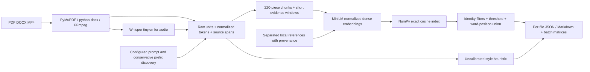

# Multimodal Submission Integrity

A Python CLI that extracts PDF/DOCX text and real MP4 speech, retrieves semantic overlaps, and writes auditable JSON/Markdown reports. It runs locally on CPU with MiniLM and Whisper tiny.en. It reports candidate overlap coverage, external-reference coverage, and a separate uncertain AI style indicator. Reviewers decide whether any overlap is improper.

## Run it

Use **Python 3.11**, x64, about 2 GB free disk space and internet for initial public dependency/model downloads. No API keys, paid services, database, or frontend are required. Windows 3.11 is tested; Python 3.12 and Linux are intended but not independently validated.

Single-command setup from the repository root:

```sh
python setup.py
```

Activate the environment, then run the required root command:

```powershell
# Windows PowerShell
.venv\Scripts\Activate.ps1
python run_integrity_check.py --input_dir ./sample_submissions --output_dir ./reports
```

```sh
# Linux/macOS
source .venv/bin/activate
python run_integrity_check.py --input_dir ./sample_submissions --output_dir ./reports
```

If activation is restricted, invoke `.venv\Scripts\python.exe` (Windows) or `.venv/bin/python` directly. Setup installs `requirements-lock.txt`, checks compatibility, and downloads immutable model snapshots into ignored `.models/`. Subsequent runs are offline. `requirements.txt` lists the direct dependencies; the lock includes all resolved transitive versions and Windows-only markers.

```sh
python -m pytest -q
python scripts/evaluate.py
python scripts/write_evaluation.py
# Optional regeneration (committed samples suffice to run/evaluate):
python scripts/generate_dataset.py
python scripts/generate_challenges.py
python run_integrity_check.py --input_dir ./challenge_submissions --output_dir ./challenge_reports
```

Dataset regeneration needs Windows SAPI English TTS, or `espeak-ng` on Linux. FFmpeg is supplied by `imageio-ffmpeg`, so no global FFmpeg installation is needed. Audio and DOCX container bytes can vary with voice/OS versions; committed sample hashes define the evaluated corpus. Generation does not substitute intended transcripts for ASR.

## What to inspect

- `reports/batch_summary.md`: all 15 inputs, statuses and three signals.
- `reports/individual/11_harbor_pitch.mp4.md`: PDF/video evidence with page 2 and bounded timestamps.
- `reports/individual/03_clinic.docx.md`: semantic paraphrases with real paragraph ordinals, no invented pagination.
- `reports/individual/10_external.pdf.md`: independent local reference source URL and provenance.
- `reports/similarity_matrix.csv`: directional candidate coverage; `max_cosine_matrix.csv`: distinct cosine diagnostics.
- `reports/extracted_documents.json` and `index_windows.json`: raw passages, source offsets, normalized text and all chunk/window identities.
- `EVALUATION.md`: measured results, scenario verification, failures and limitations. `WALKTHROUGH.md`: interview preparation.
- `REQUIREMENTS.md`: complete specification-to-evidence checklist. `AI_USE.md`: actual assistance disclosure.

Every input receives JSON and Markdown, including unsupported or failed files. Null scores and `UNABLE_TO_ASSESS` mean insufficient evidence, never zero similarity. Reports contain all evidence windows; the first three strongest source cards make initial cross-checking quick. No 30-second reviewer study was conducted.

## Architecture



`integrity/extractors.py` preserves original PDF page numbers, body paragraph/section ordinals for DOCX (including tables), and ASR segment times. Repeated top/bottom PDF lines on at least 60% of pages are excluded; configured institutional margin patterns and page-number labels handle known one-page templates. Other margins remain intact. Removed furniture is recorded. DOCX header/footer parts are separate and excluded. An image-only page is flagged for OCR; a PDF with some extractable pages is `partial` with explicit warnings.

Audio is genuinely decoded to mono 16 kHz PCM and transcribed by faster-whisper tiny.en, CPU int8, English, beam 5, temperature 0, VAD and word alignment. Silent audio and absent tracks have distinct statuses. Original ASR timing predictions and word confidences are retained, and reported bounds cannot exceed decoded media duration. Bounds are model alignment estimates; they are not manually validated forced-alignment ground truth.

`integrity/text.py` normalizes Unicode NFKC, case and whitespace while retaining immutable raw units and per-word raw offsets. Chunk IDs point to those original word positions. Model inputs are normalized; evidence passages are exact raw slices joined by newlines across source units. Every location includes `*_spans` with raw unit index and character offsets, plus page arrays, paragraph/section arrays or second ranges. Chunks crossing a page or ASR boundary retain all constituent locations; the example singular page key is the first page and the plural array is authoritative for multi-page passages.

The main chunks target **220 WordPiece tokens**, with about 35 pieces of overlap, to stay within MiniLM's 256-token context. A final short chunk, short document or isolated eligible run can be smaller than 200 tokens. Fixed 95-piece evidence windows and sentence-aligned groups supplement chunks to find short copied paragraphs that long context can dilute. Windows have distinct roles in `index_windows.json`; all are embedded and scored by the same model. These evidence windows are deliberately shorter than the main ingestion chunks.

`integrity/index.py` encodes 384-dimensional vectors with L2 normalization and uses exact NumPy inner products for cosine retrieval. It caches vectors by immutable model revision plus normalized input. `vectors.npz` stores the small evaluated index, not model weights. `integrity/matching.py` excludes only the same document identity (relative input path); a byte-identical file at a different path remains eligible. Hashes establish provenance, not self filtering. References use a separate `reference:` namespace and are filtered into the external channel.

## Scoring and thresholds

1. A candidate overlap requires cosine **>=0.80** and at least **12 words in each evidence window**. This is a prototype operating point, not a universal threshold or statistical significance level. Sentence embeddings establish semantic relatedness, not ownership or copying direction.
2. For each query window and each other source document, retain the highest-scoring source window. The report includes actual passages, raw offsets and cosine. Overlapping query windows can yield multiple cards; their coverage is deduplicated.
3. Let `E` be eligible normalized query word positions after exclusions. Let `M` be the union of query positions covered by accepted evidence windows. Report `100 * |M| / |E|`. Compute peer and external coverage independently. **Cosine is never multiplied by 100 to claim percentage plagiarized.** This is candidate-window coverage: semantic windows may include unmatched context, so it can overestimate literal copied words. Peer and external values are not additive.
4. The matrix cell query A/source B uses only B's accepted windows and A's denominator. It is directional; diagonal and unavailable comparisons are null. The separate cosine matrix shows maximum window cosine even below threshold. It is a diagnostic rather than a percentage.
5. `total_integrity_risk` is review priority: coverage >=50 HIGH, >=15 MEDIUM, otherwise LOW. The AI indicator does not increase this priority by itself. Insufficient extraction/eligible text yields UNABLE_TO_ASSESS and null values. A partial PDF is assessed only on extracted pages.

Known prompts come from `config/common_prompt.txt`, independent of relationship labels. A second conservative rule discovers only an identical opening prefix of 40-200 words shared by at least five files. It never removes repeated interior text. This can still discount coordinated copied openings, so exclusions are fully visible and should be reviewed. Five synthetic submissions contain a common **151-word** prompt and distinct answers. A challenge with the same prompt plus copied answers verifies the answers remain detectable.

Only clearly attributed quotations in the form `"quotation" (Source: attribution)` or `(Cited: attribution)` and paragraphs starting `References:`/`Bibliography:` are discounted. This is narrow syntax, not a comprehensive citation parser. A full PDF page beginning with a reference heading can exclude more than a DOCX paragraph. Quotes and references remain in raw extraction/exclusion audit data, and attribution does not prove a source is legitimate. Do not use these rules to grant misconduct exemptions automatically.

The external corpus is **locally authored synthetic reference material, not a web search**. Its URL points to the exact committed private GitHub source; an evaluator needs repository access. Provenance explicitly states CC0 authorship and that it was not scraped. A local reference corpus is permitted by the brief. External coverage is limited to this corpus and cannot certify absence of internet copying.

The `ai_generated_probability` example key is retained as a compatibility field. Its value is an **uncalibrated style index**, computed as 100 times `0.55 * sentence-length regularity + 0.30 * lexical repetition + 0.15 * capped transition frequency`. Exact features and formula are in `integrity/signals.py`. At least 50 words and three sentences are required. No training, perplexity estimate, classifier or probability calibration is claimed. Human writing can score high and AI writing low; all sample prose was AI-assisted, so this dataset cannot validate human-vs-AI classification.

## Assumptions

- This prototype handles English text and short English clips; no OCR, translation, live crawling or paid API.
- The requested 15 submissions are 5 valid PDFs, 5 DOCX, 3 spoken MP4s, 1 no-audio MP4 and 1 zero-byte PDF. The invalid PDF is additional to the five valid PDFs. Challenge inputs are a separately labelled diagnostic suite.
- Synthetic independently composed answers are independent in content, not human-authored. Every text's AI provenance is disclosed. Ground-truth labels and intended speech are used only by generation/evaluation; runtime never reads them.
- PDF page numbers are actual 1-based container pages; DOCX paragraph ordinals count body paragraphs and table-cell paragraphs, including empty ones. DOCX section references are the latest heading text, not rendered pagination.
- Inputs are bounded to 100 MiB, 500 PDF pages and 120 audio seconds. This assessment's clips are about 16-21 seconds. Extraction failures are isolated; shared model/configuration failures stop with setup guidance.
- No plagiarism or AI signal is an automatic misconduct decision. No evidence establishes which peer is the original author.
- Reviewer identity and portal were absent from the invitation; no handle is guessed, the repository stays private, and portal preparation/submission is left to the user.

## Scaling to 10,000 submissions

The current exact all-window matrix is appropriate for 15 inputs, and is **not** a production 10,000-document implementation. A production design would use object storage for originals, audio, transcripts and immutable report artifacts, with relational job/source/chunk metadata and a dedicated vector index.

An upload API should validate metadata and write an idempotent job keyed by content hash, challenge ID, document identity, model revisions and scoring version. Use asynchronous queues such as RabbitMQ/Redis Streams with separate bounded extraction, audio/ASR, embedding and retrieval/report workers. Return a job ID promptly; 10,000 simultaneous uploads must be queued instead of opening 10,000 decoders or model copies. Apply per-file time/memory/page/duration limits, backpressure, retry transient storage/model failures with bounded exponential backoff, and send permanent invalid files to a terminal unavailable state. Acknowledge only after persisted state; leases and idempotent upserts prevent duplicate work following worker crashes.

CPU workers suit PDF/DOCX parsing, FFmpeg and short tiny ASR jobs. Bound decoder concurrency to physical cores/RAM and isolate parsers in containers. CPU int8 is economical for low volume; a shared GPU ASR worker can batch longer backlogs if free capacity exists. Batch embeddings across documents (for example 32-128 windows, benchmark the hardware), reuse loaded models, and cache transcription by audio hash+ASR version and embeddings by normalized input hash+model version. Never cache a previous peer score across a changed challenge corpus without invalidation.

Store normalized float32 vectors with document/chunk IDs and page/paragraph/time metadata. Exact Flat retrieval is simple and provides an evaluation reference. At production scale, choose HNSW in a persistent vector service (for example FAISS HNSW with durable metadata or a vector database), filter by tenant/challenge and exclude the query document ID, retrieve top-k candidates, then rerank by exact cosine and apply evidence/coverage rules. Separate external-corpus membership from peers. HNSW trades approximate recall and extra graph RAM/build time for much lower query latency. Measure recall@k against Flat on a held-out subset, tune `M`/`efSearch`, and retain exact reranking. Immutable per-challenge snapshots make all reports reproducible as submissions arrive or are withdrawn.

**Planning estimates, not measured production results:** assume 10,000 documents, 20 main chunks each and 5 evidence windows per chunk: 1.2 million vectors. At 384 dimensions * 4 bytes, raw vectors need about **1.84 GB decimal** before metadata/HNSW graph overhead. A full pairwise matrix would need about **5.76 TB** float32 and is inappropriate; a 10,000-by-10,000 document matrix alone is 400 MB and usually better exported sparsely. Metadata filtering and top-k retrieval avoid materializing all pairs. Sentence-window expansion can exceed these assumptions, so enforce/document a production window budget and measure its effect on recall.

For another capacity estimate, assume 2,000 clips averaging 30 seconds (16.7 audio hours), CPU ASR real-time factor 0.25, eight independent workers: about 31 minutes of idealized ASR service time. This excludes queueing, model loads, I/O and retries and **is not extrapolated from a measured 30-second throughput test**. If embeddings reach 500 windows/second on provisioned hardware, 1.2 million windows take about 40 minutes per worker; this rate is an explicit assumption to benchmark, not a claim about this laptop. At the current small workload measured times include startup and caching effects; see EVALUATION.md.

Cost is dominated by ASR compute, embedding windows and retention of original video, then HNSW RAM and object-store requests. Dollar costs depend on provider/region; no paid resource is provisioned or quoted. Queue age, seconds of audio pending, per-stage throughput, p50/p95 latency, retry counts, parser failures, cache hit rate and retrieval recall are the useful capacity signals. Compute service time is distinct from end-to-end latency: submission bursts, cold models, storage bandwidth and large videos drive tail latency. Use autoscaling with hard concurrency/budget caps rather than assuming free-tier GPUs are always available.

## Troubleshooting and limitations

- Missing model folders: `python setup.py --skip-install` from an environment with dependencies installed. Initial downloads require network access to Hugging Face; runtime itself uses `local_files_only=True`.
- An unavailable/corrupt file: inspect that file's `extraction.status` and `warnings`. Other files continue. `scanned`/empty extraction needs an OCR extension; do not interpret it as an originality result.
- No-audio video differs from a muted audio stream (`no_audio` versus `silent`). Non-speech or extremely quiet audio can also be unassessable.
- Short excerpts below 12 words can be missed. Contradictory statements can have high cosine. See the committed challenge outputs rather than treating the synthetic benchmark's perfect pair metrics as general accuracy.
- The matrix is exact and quadratic in indexed windows; use the scaling design for larger batches. Reports retain overlapping evidence windows, which can be verbose.
- The source text/labels were constructed with knowledge of the requirements, and one retrieval fix was informed by this dataset. There is no held-out natural/student validation set, real accent/noise robustness test, statistical detector calibration, or verified production benchmark.

## AI assistance disclosure

**This project was largely built by OpenAI Codex at the candidate's request**, including architecture, implementation, synthetic data/scripts, tests, execution/debugging, evaluation and documentation. It would be inaccurate to call this only boilerplate assistance. The brief explicitly mentions assistants for boilerplate and debugging; this level of assistance goes beyond that wording. The candidate must clarify whether the broader assistance is permitted before submitting, review the actual code, and be able to explain every part. See `AI_USE.md` for scope and responsibilities. No claim is made that the candidate independently wrote or validated this implementation.
